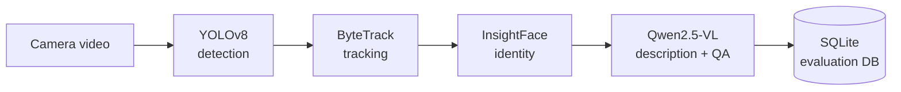

<h1 align="center">Prakriti Adhikari</h1>

  <b>Computer Vision · Vision-Language Models · Multimodal AI · Embodied Systems</b> 
  Computer Engineering student, Nepal

  
  
  

---

## About
I build and evaluate AI systems that perceive, track and reason about the real world. My work moves from perception (detection, tracking, recognition) toward multimodal understanding (vision-language models, retrieval, memory) and systems that act (embedded and real-time control).

I care about measuring whether these systems actually work: ground-truth evaluation, confidence intervals, and reporting negative results.

---

## Featured Project

### HomeGuard: Multimodal Event Understanding for Home Surveillance
*Designed, built and evaluated by me.*

  

HomeGuard turns camera video into searchable, answerable events.

**Pilot study: single-frame vs five-frame VLM summarization** (10 controlled events, 40 questions, 12 temporal)

| Metric | Single-frame | Five-frame fusion |
|---|---|---|
| Temporal-question accuracy | 33.3% (4/12) | **66.7% (8/12)** |
| Hallucination rate | **10%** | 30% |
| Latency | **1×** | ~5× |

Overall difference was not statistically significant (exact McNemar p = 0.81). More temporal context helps temporal questions but costs reliability and speed, which motivates linking person tracks to specific actions and moments.

| Repo | Contents |
|---|---|
| [homeguard-eval](https://github.com/prakritiadhikari01/homeguard-eval) | Evaluation harness, questions, analysis, results |
| [homeguard-ai](https://github.com/prakritiadhikari01/homeguard-ai) | Detection, tracking, identity and VLM pipeline |
| [homeguard-app](https://github.com/prakritiadhikari01/homeguard-app) | Django REST backend and web frontend |

---

## More Projects

<table>
<tr>
<td width="50%" valign="top">

### ReflectCast
AI-powered podcast generator. Turns written reflections into personalized spoken podcasts using ChromaDB embeddings as contextual memory, iterative prompt design, and ElevenLabs TTS.

[Demo](https://youtu.be/S3u2gP0L9tc) · [Code](ADD-REPO-LINK)

</td>
<td width="50%" valign="top">

### Traffix
Smart traffic light automation. Real-time vehicle detection (YOLOv8 + OpenCV) estimates lane congestion and drives adaptive signal timing on ESP32 hardware.

[Code](ADD-REPO-LINK)

</td>
</tr>
</table>

---

## Tech

  

Also: ByteTrack, InsightFace, Ollama, ChromaDB, Celery, NumPy, Pandas
